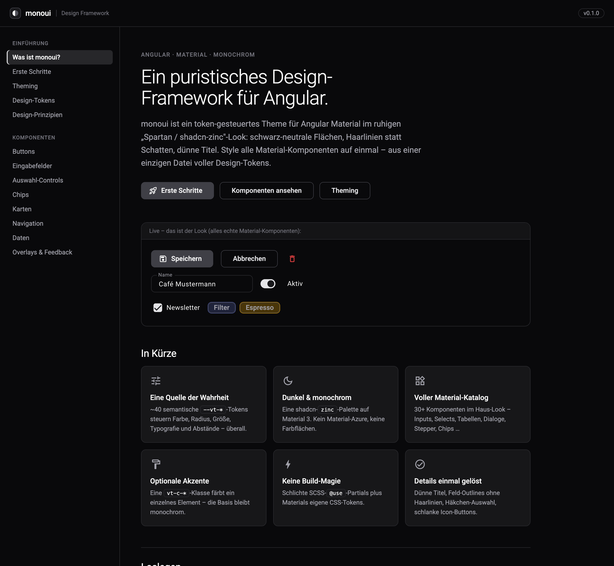

# Onur Ünal

**Fachinformatiker für Anwendungsentwicklung · Anwendungen, KI-Integration und Entwicklerwerkzeuge**

Ich entwickle Software, die konkrete Arbeitsabläufe vereinfacht: von Desktopanwendungen und wiederverwendbaren Oberflächen bis zur Anbindung von KI-Modellen. Mein Schwerpunkt liegt auf TypeScript, Angular, Electron und Node.js.

Hier zeige ich ausgewählte eigene Projekte. Meine aktuelle Entwicklungspraxis stammt überwiegend aus diesen Projekten. Ich arbeite mit KI-Programmierassistenten; Konzeption, Integration und Prüfung der Ergebnisse liegen bei mir.

## Direkt in den Code

### [Vuetify AI Setup für OpenCode](https://github.com/OnurUenal/vuetify-ki-setup)

Wie lassen sich Oberflächenregeln bei der Arbeit mit Coding-Agenten überprüfen? Das Projekt verbindet Projektanweisungen, ESLint-Regeln für Vue-Templates und ein OpenCode-Plugin, das Lint-Fehler nach einer Änderung an den Agenten zurückmeldet.

- **Konkret ansehen:** [Lint-Regeln](https://github.com/OnurUenal/vuetify-ki-setup/blob/main/eslint.config.js) · [Feedback-Plugin](https://github.com/OnurUenal/vuetify-ki-setup/blob/main/.opencode/plugins/vue-lint-feedback.js)
- **Technik:** JavaScript, Vue 3, Vuetify, ESLint, OpenCode
- **Grenze:** Lint kann Regeln prüfen. Ob ein Modell die Rückmeldung richtig umsetzt, muss zusätzlich getestet werden.

## Größere Eigenprojekte

### [Monodesk — Arbeitsumgebung für Coding-Agenten](https://github.com/OnurUenal/OnurUenal/blob/main/projects/monodesk.md)

Desktopanwendung mit Kanban, Datei- und Dokumentenarbeit, Terminal und KI-Anbindung. Ein Schwerpunkt ist die nachvollziehbare Arbeit mehrerer Agenten: getrennte Git-Worktrees, festgelegte Werkzeugrechte sowie Tests und Reviews vor der Übernahme von Änderungen.

**Mein Beitrag:** Konzeption, Oberfläche, Backend, Modellanbindung und Weiterentwicklung der Prüfabläufe mit KI-Unterstützung. **Technik:** Electron, Angular, TypeScript, Node.js, MCP.

### [monoui — Designsystem für Angular Material](https://github.com/OnurUenal/OnurUenal/blob/main/projects/monoui.md)

Aus einem eigenen Vertriebstool entstand eine gemeinsame Gestaltung für weitere Anwendungen. Design-Tokens, angepasste Material-Komponenten und eigene UI-Bausteine sorgen für ein einheitliches Erscheinungsbild; eine Beispielanwendung dokumentiert die Nutzung.

**Mein Beitrag:** Überführung der Oberfläche in ein wiederverwendbares System, Komponenten und Dokumentation. **Technik:** Angular, Angular Material/CDK, TypeScript, SCSS.

Monodesk und monoui sind hier als Projektbeschreibungen dargestellt. Der vollständige Quellcode dieser beiden Projekte ist derzeit nicht öffentlich.

## Wie ich arbeite

Ich zerlege Anforderungen in überprüfbare Schritte, verbinde Oberfläche und Schnittstellen und prüfe Änderungen mit passenden Tests und Reviews. Bei KI-Funktionen interessieren mich besonders Fehlerfälle: Was passiert, wenn ein Werkzeug ausfällt, Kontext fehlt oder ein Ergebnis nicht belegt ist?

Ich suche eine Remote-Position in der Anwendungsentwicklung oder KI-Integration, in der ich diese Erfahrung einbringen und im Team weiterentwickeln kann.
