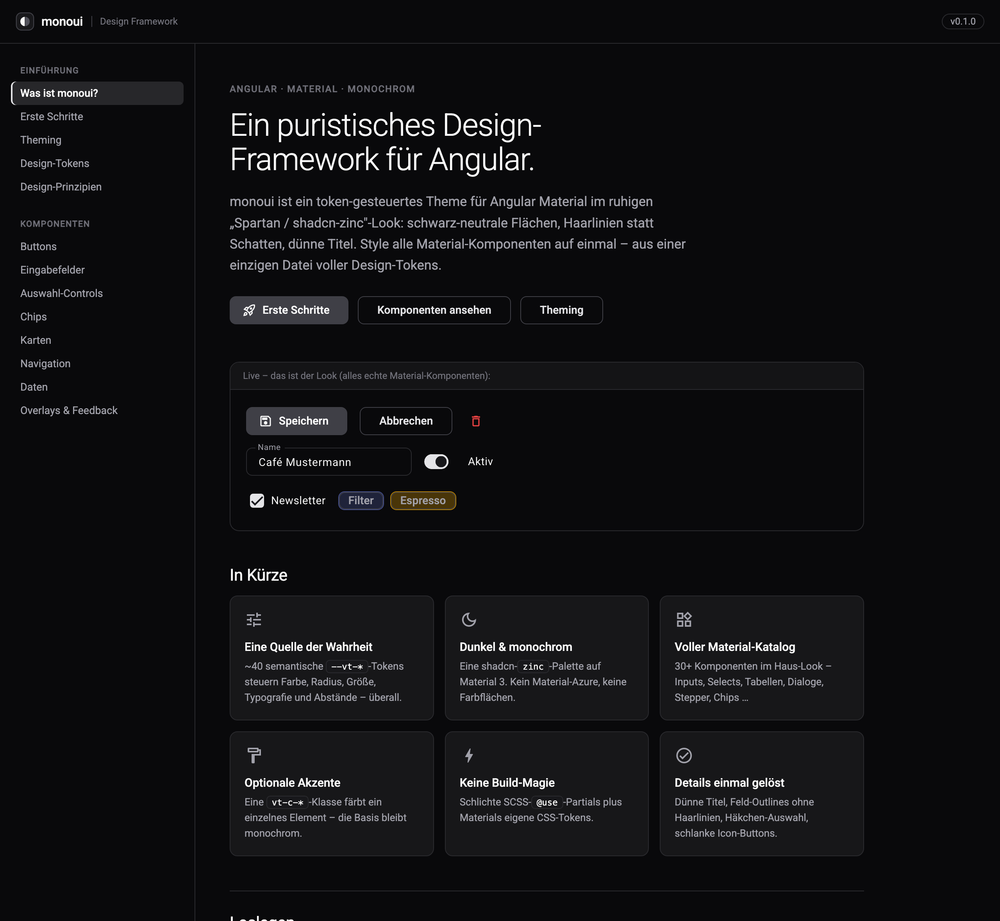

# monoui

**Eigenprojekt · Angular Material, TypeScript und SCSS · Quellcode derzeit nicht öffentlich**

## Ausgangspunkt

Eine individuell gestaltete Anwendung lässt sich nur schwer auf weitere Projekte übertragen, wenn jede Komponente eigene Farben, Abstände und Sonderregeln mitbringt. monoui entstand aus der Oberfläche eines eigenen Vertriebstools, um diese Entscheidungen an einer gemeinsamen Stelle zu pflegen.

## Umsetzung

Die Grundlage bildet eine Theme-Schicht für Angular Material. Semantische Design-Tokens steuern Farben, Abstände, Radien und Steuerhöhen. Ergänzende UI-Bausteine decken wiederkehrende Aufgaben ab, etwa Seitenüberschriften, leere Zustände, Suchfelder und Statusanzeigen. Eine Beispielanwendung zeigt die Gestaltung und dokumentiert die Verwendung.

## Mein Beitrag

Ich habe die Gestaltung aus dem ursprünglichen Anwendungszusammenhang herausgelöst und in ein wiederverwendbares System überführt. Dazu gehören Theme, eigene Bausteine und die zugehörige Dokumentation, entwickelt mit KI-Unterstützung und eigener Prüfung.

## Einblick

Die folgende Aufnahme zeigt die vorhandene Dokumentationsoberfläche mit Beispieldaten. Sie illustriert das Erscheinungsbild; sie ist kein aktueller Funktionstest.

## Technische Entscheidungen

- **Angular Material als Grundlage:** vorhandene Komponenten weiterverwenden.
- **SCSS und CSS-Custom-Properties:** Gestaltungsentscheidungen zentral pflegen.
- **Eigene UI-Bausteine:** wiederkehrende Muster projektübergreifend zusammenfassen.
- **Beispielanwendung:** Gestaltung und Verwendung direkt nebeneinander zeigen.

## Stand

monoui wird in eigenen Projekten weiterentwickelt. Es ist derzeit kein öffentlich veröffentlichtes npm-Paket. Der Screenshot und diese Beschreibung geben einen Einblick; ein öffentliches Quellcode-Repository ist damit nicht verbunden.

[Zurück zum Profil](https://github.com/OnurUenal)
